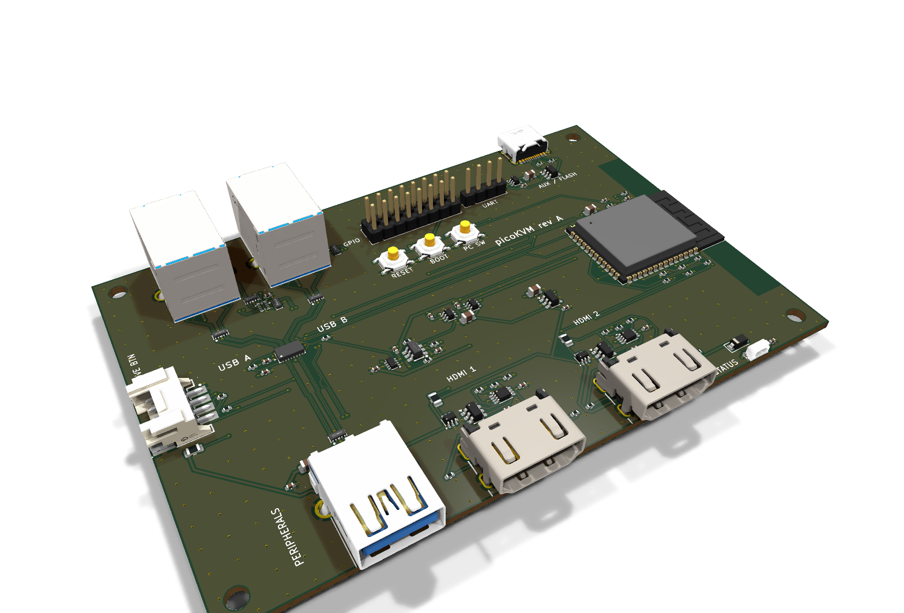
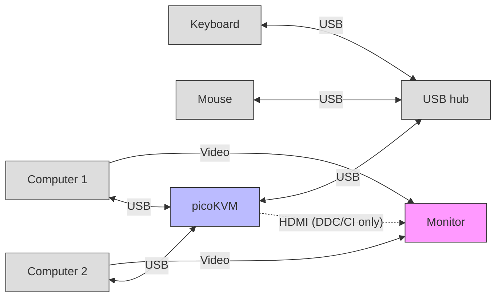

# PicoKVM
An inexpensive network KVM that can switch USB and monitor inputs simultaneously

## Why
Samsung makes great monitors, but they often lack a KVM. The project started as a way to switch them along with the USB devices, over their network API. It was later generalized to most monitors, driven over HDMI DDC/CI by its own board, while still driving network-controlled monitors and devices.

## Features
- Switches the USB devices and the monitors' inputs together
- Drives most monitors over HDMI DDC/CI, and others (or any device: a lamp, ...) over the network
- No video goes through it: every computer is connected directly to every monitor, so HDCP, VRR, G-Sync, FreeSync, HDR, ... work natively
- Controlled from its button, a web page or an HTTP API, from any device on the network

## Hardware
picoKVM runs on its own board, designed in [`hardware/`](hardware/README.md): an ESP32-S3, a USB 3.0 switch (two computers, one peripheral port), two HDMI ports carrying DDC/CI only (no video) to switch monitor inputs, an RGB status LED, and a Grove port for an [M5Stack key unit](https://shop.m5stack.com/products/mechanical-key-button-unit) as the switch button.



The original build (M5Stack AtomS3 Lite + USB multiplexer) is no longer supported; its last version is [5d5997c](https://github.com/FuNK3Y/picoKVM/tree/5d5997c).

## Install
1. Open the **[browser installer](https://funk3y.github.io/picoKVM/)** in Chrome or Edge, and plug the board's AUX / FLASH USB-C port into the computer.
2. Install, then connect the board to your Wi-Fi from the same page.
3. *Visit device* opens the [settings page](#settings): set the [admin password](#admin-password) first, then the input names and the monitors.

## Wiring
- Computers' video goes directly to the monitors, as without a KVM.
- Each computer's USB goes to the board; the keyboard and mouse go to its peripheral port, through a hub (the monitor's own hub works).
- For monitors driven over DDC/CI, an HDMI cable goes from one of the board's HDMI ports to the monitor. It carries only the input-switch commands, no video. Monitors driven over the network need none.



## Settings
The settings page (*Settings*, below the switch button at `http://picokvm.local`) edits everything: Wi-Fi, input names and colors, LED brightness, admin password, monitors and [updates](#updates).

### Admin password
Once set, the admin password protects everything the settings page does: opening it, reading and changing the configuration, and installing updates, from the page or through the API. The browser asks for it (any user name); API calls send it as HTTP Basic credentials, e.g. `curl -u admin:<password>`. Switching inputs, the state and `/metrics` stay open.

**Until it is set, all of that is open to anyone on the network.**

It travels over plain HTTP, so anyone able to watch the network traffic can read it.

### Monitors
Monitors are added on the settings page: a form for DDC/CI monitors, JSON for the others ([`config.example.json`](config.example.json) has an example of each).

#### DDC/CI monitors
Enable DDC/CI in the monitor's menu. For each computer, choose the monitor input it is on. The settings page reads the monitor: its name, the input it is on now, and the inputs it lists, named as the MCCS standard names them (VCP `0x60`: `15` DisplayPort 1, `17` HDMI 1, ...). Some monitors use other values, or name their ports differently: put the monitor on each computer's input by hand, and the page shows which value it is (*Other value...* takes any number). *Power the monitor on first* wakes up monitors that keep DDC/CI alive in standby.

The monitor must accept DDC/CI on an input that is not the active one, since it is showing the other computer when the command arrives. Most do: tested on **AOC, Samsung, Dell, Acer, Philips and Lenovo** monitors. Some have no DDC/CI at all (the Samsung G80SD): drive those over the network.

#### Samsung monitors over the network
For Samsung smart monitors without DDC/CI, the KVM sends remote-control key presses: enable IP remote on the monitor *(Connection > Network > Expert Settings)*. Find a repeatable sequence of keys that selects each input from the home screen, and write it with the [key codes](https://github.com/ollo69/ha-samsungtv-smart/blob/master/docs/Key_codes.md) as a `SamsungMonitor`. `KEY_RETURN` first also wakes the monitor up; `command_delay` (or a `delay` on one key) slows the sequence down if the menu cannot keep up.

#### Other network devices
A `GenericDevice` sends an HTTP request for each input: another monitor's API (e.g. [SmartThings](https://github.com/ollo69/ha-samsungtv-smart/issues/274#issuecomment-2597627685), untested), a lamp, ...

## Use
Switch with the button, the web page at `http://picokvm.local` (it follows the KVM whoever switches it), or the API:
```sh
curl -X POST http://picokvm.local/api/active_input/A   # or B; without the input, toggles
curl http://picokvm.local/api/active_input             # the state: active input, switching, last error
curl http://picokvm.local/api/events                   # the state as server-sent events, on every change
```
`/api/config` reads (`GET`) and writes (`POST`) the configuration, without the passwords ([admin password](#admin-password) required). `/metrics` gives Wi-Fi signal, memory, USB power and version for Prometheus.

`picokvm` is the default hostname; it can be changed in the settings.

## Updates
*Check for updates*, then *Install*, on the settings page installs the latest [release](https://github.com/FuNK3Y/picoKVM/releases) over the network; *Upload* installs a `firmware-ota.bin` of your own. Settings are kept. The first boot of an update is a trial: if the device is not back on Wi-Fi within 2 minutes, it returns to the previous firmware.

The same through the API, with the [admin password](#admin-password):
```sh
curl -u admin:<admin_password> -X POST http://picokvm.local/api/update/latest
curl -u admin:<admin_password> --data-binary @firmware-ota.bin http://picokvm.local/api/update
```

MicroPython does not check GitHub's certificate when downloading a release: the SHA-256 GitHub publishes only guards against a corrupted download.

## ESPHome
The board can also run [ESPHome](https://esphome.io) instead of this firmware, for a native Home Assistant integration (DDC/CI monitors only). Include the [esphome/picokvm.yaml](esphome/picokvm.yaml) package, then name the computers and set the number of monitors:

```yaml
packages:
  picokvm: github://FuNK3Y/picoKVM/esphome/picokvm.yaml@main

substitutions:
  inputs:
    a: Work laptop
    b: Gaming PC
  monitors: 2
```

Each monitor's input values are then set from Home Assistant. [esphome/example.yaml](esphome/example.yaml) is a complete starting point; it builds, but has not been run on a board yet.

## Development
[`firmware/build.sh`](firmware/build.sh) builds MicroPython with `src/` frozen in, into `firmware/build/` (needs [ESP-IDF](https://docs.espressif.com/projects/esp-idf/en/v5.5.2/esp32s3/get-started/) v5.5.2):
```sh
. $IDF_PATH/export.sh
firmware/build.sh
```
CI runs the same build on pull requests and `main` and keeps the images as an artifact. A `v*` tag publishes a release and the [installer](install/index.html) to GitHub Pages.

The tests run the application on CPython, with stand-ins for the board ([`tests/mocks.py`](tests/mocks.py)); CI requires 95% coverage:
```sh
python3 -m unittest discover -s tests
```
