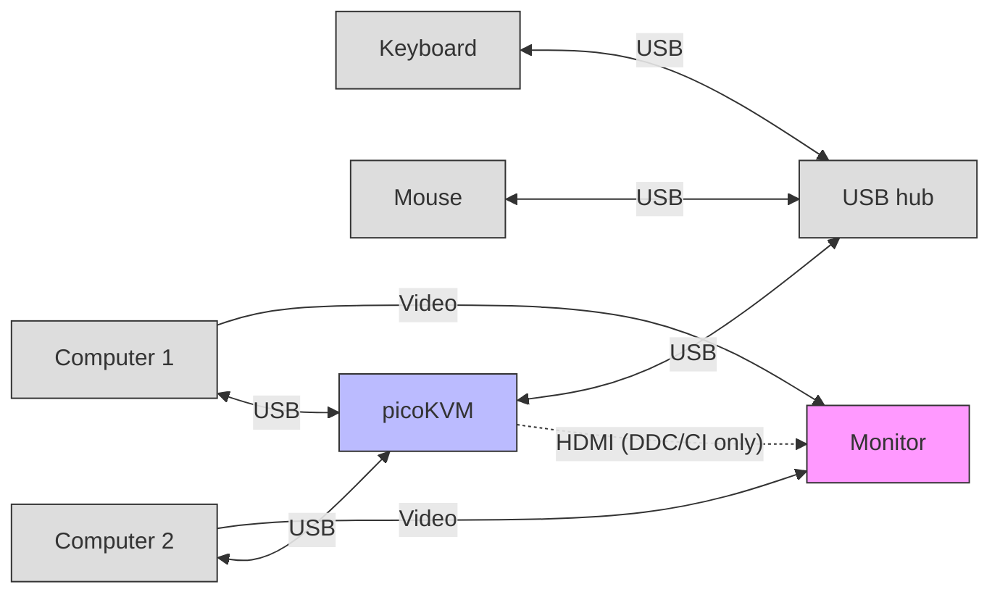

# PicoKVM
An inexpensive network KVM that can switch USB and monitor inputs simultaneously

## Why
Samsung makes great monitors, but they often lack a KVM. This project's ambition is to take advantage of the smart features of those monitors to build one with unique features.

## Features
The networking enables some unique features:
- It can control as many monitors as you can connect to your computers, as long as those can be driven over IP
- Monitor signal is not subject to any degradation, as every computer is connected directly to each monitor
- Other devices can be controlled as well - provided they can be driven by IP
    - You could for instance switch the color of a lamp - based on the selected input of the KVM
- HDCP, VRR, G-Sync, FreeSync, HDR, ... all works natively without gimmick such as EDID emulation - because every computer is directly connected to every monitor
- You can control the KVM from any device on the same network (phone, tablet, computer, ...)

## How does it works
The KVM switches the USB devices between two computers and tells the monitors to change input at the same time. Monitors are driven directly over HDMI DDC/CI by the board, or over the network (Samsung remote API, SmartThings or any HTTP API).

With the Samsung remote API, the KVM uses the Samsung remote API (https://samsungtv:8002/api/v2/) to inject key presses in order to change inputs. As on my monitors (G80SD & M70d) there is sadly no key directly mapped to inputs (like `KEY_DISPLAYPORT`, `KEY_HDMI1`). I had to build a sequence of key presses starting from the home screen. The interface is snappy enough to smoothen up this downside.

Another alternative would be to use the [SmartThings REST API](https://github.com/ollo69/ha-samsungtv-smart/issues/274#issuecomment-2597627685) - as this API allows for direct input selection. 

## Hardware setup
The firmware runs on the picoKVM board only. The original build (M5Stack AtomS3 Lite + USB multiplexer) is not supported anymore: the last version supporting it is [5d5997c](https://github.com/FuNK3Y/picoKVM/tree/5d5997c), installed by copying the files to the board.

A dedicated board, designed in this repository ([`hardware/`](hardware/README.md)): an ESP32-S3 module, a USB 3.0 switch (two USB-B inputs for the computers, one USB-A port for the peripherals, including peripheral power switching and current limiting), two HDMI ports carrying DDC/CI only (no video) to switch monitor inputs, an RGB status LED, and a Grove port for an [M5Stack mechanical key unit](https://shop.m5stack.com/products/mechanical-key-button-unit) used as the switch button.


Its pin map is in [hardware/README.md](hardware/README.md#firmware-contract). Connect an HDMI cable from each HDMI port to a monitor whose input should follow the KVM, and enable DDC/CI in the monitor's menu.

## Software setup
The firmware is MicroPython with this repository's code (`src/`) built in. Each [release](https://github.com/FuNK3Y/picoKVM/releases) has two files:
- `firmware.bin`: the full image, flashed over USB;
- `firmware-ota.bin`: the application alone, for [updates](#updates) over the network.

Flash `firmware.bin` over the board's AUX / FLASH USB-C port (hold BOOT, press RESET, release BOOT):
```sh
esptool.py erase_flash
esptool.py write_flash 0 firmware.bin
```
Erase first: the flash layout (two application slots, for updates) is not the plain MicroPython one, and a leftover filesystem would not mount. This also wipes `config.json`: coming from an install that copied the files to the board, back it up first with `mpremote cp :config.json config.json`. The USB port is the MicroPython REPL afterwards.

Copy `config.example.json` to `config.json` and adjust it with your settings. You need to configure at least your Wi-Fi credentials and your monitors. Upload it to the board and restart it, e.g. with [mpremote](https://docs.micropython.org/en/latest/reference/mpremote.html) (or [Thonny](https://thonny.org/)'s file view):
```sh
mpremote cp config.json :config.json + reset
```

`config.json` is deliberately not tracked by git: the device rewrites it at runtime to persist the monitor pairing token, so it ends up holding both that token and your Wi-Fi password.

### Settings

The board's pins are fixed in the firmware ([`src/board.py`](src/board.py)). Besides `wireless_network`, `inputs` (name and LED color of each computer) and `devices` (the monitors, below):

| key | what |
|---|---|
| `led_idle_brightness` | `0`: LEDs off after a switch; `0` to `1`: keep showing the active input's color at that brightness |
| `admin_password` | required, as HTTP Basic credentials with any user name, by the API calls that change the device ([updates](#updates)); while empty, they are refused |
| `update_repository` | GitHub repository whose latest release the device updates to (default `FuNK3Y/picoKVM`) |

A `config.json` from an earlier version still loads: its pin settings are ignored. Only its `DdcMonitor` devices need `"hdmi": 1` (or `2`) in place of `sda_gpio_pin` / `scl_gpio_pin`.

Then, you need to configure your monitor. DDC/CI (below) needs no network. Otherwise, either make sure that IP remote is enabled *(Connection > Network > Expert Settings)* or configure SmartThings

### DDC/CI
Each HDMI port of the board is a `DdcMonitor` device: `hdmi` is `1` or `2`. `inputs` maps `A` and `B` to the VESA MCCS value of the monitor's input source (VCP `0x60`): commonly `15` (DisplayPort 1), `16` (DisplayPort 2), `17` (HDMI 1), `18` (HDMI 2). Some monitors use their own values: read VCP `0x60` with a DDC tool (`ddcutil getvcp 60` on Linux, *ControlMyMonitor* on Windows) while each input is active. `power_on` also sends power-on (VCP `0xD6`) first, for monitors that keep DDC/CI alive in standby.

```json
{
    "data": {
        "hdmi": 1,
        "inputs": {"A": 15, "B": 17},
        "power_on": false
    },
    "type": "DdcMonitor"
}
```

**The monitor must accept DDC/CI commands on an input that is not the active one.** The KVM's HDMI cable is only a control link: the monitor is showing a computer on another input when the command arrives, so DDC/CI has to stay enabled and responsive on inactive inputs. Most monitors with a DDC/CI setting do this, but check yours (e.g. with a laptop plugged into a spare input and `ddcutil`/ControlMyMonitor).

This has been successfully tested so far on **AOC, Samsung, Dell, Acer and Lenovo** monitors. Not every monitor implements DDC/CI (the Samsung G80SD does not); use one of the network APIs below for those.

### Samsung Remote API
Using your remote, find a repeatable pattern of key presses that will allow you to select the correct input. Then, using the [key code reference](https://github.com/ollo69/ha-samsungtv-smart/blob/master/docs/Key_codes.md), adjust `config.json` accordingly.

The pattern will be different for every input (`A` & `B`).

### Example:
```json
"command_sequences": {
    "A": [
        {
            "command": "KEY_RETURN",
            "delay": 2.2
        },
        "KEY_SOURCE",
        {
            "command": "KEY_LEFT",
            "repeat": 10
        },
        {
            "command": "KEY_RIGHT",
            "repeat": 2
        },
        "KEY_ENTER"
    ],
    "B": [
        {
            "command": "KEY_RETURN",
            "delay": 2.2
        },
        "KEY_SOURCE",
        {
            "command": "KEY_LEFT",
            "repeat": 10
        },
        {
            "command": "KEY_RIGHT",
            "repeat": 3
        },
        "KEY_ENTER"
    ]
    }
```
You can finally fine-tune the delay between each command to make sure the interface can keep track of those (`command_delay`). Optionally, the delay for a given command can be overriden - should it be slower than the rest.

If the monitor is not powered on during an input switch, it will be automatically turned on (this is what `KEY_RETURN` is for)

### SmartThings API
I did not try it, but creating a device of type `GenericDevice` with [this payload](https://github.com/ollo69/ha-samsungtv-smart/issues/274#issuecomment-2597627685) should work fine.

### Example:
```json
{
    "data": {
        "uri": "https://api.smartthings.com/v1/devices/deviceId/commands",
        "method": "POST",
        "kwargs": {
            "A": {
                "headers": {
                    "Content-Type": "application/json",
                    "Authorization": "Bearer token"
                },
                "data": "{\"commands\":[{\"component\":\"main\",\"capability\":\"samsungvd.mediaInputSource\",\"command\":\"setInputSource\",\"arguments\":[\"Display Port\"]}]}"
            },
            "B": {
                "headers": {
                    "Content-Type": "application/json",
                    "Authorization": "Bearer token"
                },
                "data": "{\"commands\":[{\"component\":\"main\",\"capability\":\"samsungvd.mediaInputSource\",\"command\":\"setInputSource\",\"arguments\":[\"HDMI1\"]}]}"
            }
        }
    },
    "type": "GenericDevice"
}
```

### ESPHome
The board can run [ESPHome](https://esphome.io) instead of this firmware, for a native Home Assistant integration. [esphome/picokvm.yaml](esphome/picokvm.yaml) is the board's core logic as an ESPHome package, built from stock components only:
- the `Input` select moves the USB peripherals, power-cycling the peripheral port as the firmware does, and switches the monitors over DDC/CI (an `i2c_device` per HDMI port and a few-line lambda that sends VCP 0x60);
- the button cycles the inputs, and the LEDs show the active input;
- VBUS and peripheral fault are binary sensors.

Samsung and generic HTTP devices are not covered; drive them from Home Assistant if you need them.

Each monitor's **HDMI n input for &lt;computer&gt;** is set at runtime, from Home Assistant (device page, Configuration) or the ESPHome web server, no rebuild needed: the VCP 0x60 value that shows that computer on the monitor (decimal: 15 DisplayPort 1, 16 DisplayPort 2, 17 HDMI 1, 18 HDMI 2).

Your own config includes the package, names the computers and sets the number of monitors (1: HDMI 1 only, 2: both). Both are build-time: Home Assistant caches a select's options, and the HDMI 2 settings only exist with 2 monitors:

```yaml
packages:
  picokvm: github://FuNK3Y/picoKVM/esphome/picokvm.yaml@main

substitutions:
  inputs:
    a: Work laptop
    b: Gaming PC
  monitors: 2
```

Add anything else the board should do in the same file; `!extend kvm_input` hooks onto the core select. [esphome/example.yaml](esphome/example.yaml) is a complete starting point. Flash it the first time over the AUX USB-C with `esphome run example.yaml`. It builds with ESPHome 2026.9.1 but has not been run on a board yet.

## How to use
Here is how to connect everything together:
- Connect computers directly to the monitors
- Connect USB from the computers to the KVM
- Connect keyboard & mouse to a USB hub - itself connected to the KVM
- Connect the board's HDMI 1 / HDMI 2 ports to the monitors that should switch over DDC/CI (control only, the video still goes directly from the computers to the monitors)
    - The USB hub in the schema can be the primary monitor's built-in hub. In the case of the G80SD it retains the capability to drive the smart features of the monitor with the keyboard & mouse

### Schema

The dashed link is the picoKVM board's HDMI port: it carries only DDC/CI to switch the monitor's input (no video). With network-controlled monitors (Samsung remote API, SmartThings, ...) it is not needed.

On top of the physical button, there are two ways to operate the KVM. You need to know the `$hostname` of the device to connect (default value is picokvm)

### Web page
Simply connect to `http://$hostname.local` and press the button. Below it are the firmware version and its [updates](#updates).

### API
Issue a `POST` request to `http://$hostname.local/api/active_input/A` or `B`.

**_NOTE:_** If the input name is omitted, it will act as a toggle.

#### PowerShell example:
```powershell
Invoke-RestMethod -Method POST "http://$hostname.local/api/active_input/A"
```

### Troubleshooting
Pressing the button for more than 10 seconds will reset the device
`/metrics` provide memory related information and wifi signal strength (plus which computers power their USB port, and the peripheral fault flag). It can be ingested by prometheus

## Updates
The firmware updates itself over the network, MicroPython included. Set `admin_password` in `config.json` first: updates are refused without it.

The simplest is from the web page: *Check for updates* looks up the latest [release](https://github.com/FuNK3Y/picoKVM/releases), and *Update to …* installs it (the browser asks for the password). The same through the API:
```sh
curl http://$hostname.local/api/update/latest                                     # {"version": ..., "latest": ..., "update_available": ...}
curl -u admin:<admin_password> -X POST http://$hostname.local/api/update/latest   # downloads and installs it
```

Or upload `firmware-ota.bin`, from a [release](https://github.com/FuNK3Y/picoKVM/releases) or from the artifact of any [GitHub Actions run](https://github.com/FuNK3Y/picoKVM/actions/workflows/firmware.yml):
```sh
curl -u admin:<admin_password> --data-binary @firmware-ota.bin http://$hostname.local/api/update
```
```powershell
Invoke-RestMethod -Method POST -InFile firmware-ota.bin -Authentication Basic -Credential (Get-Credential) -AllowUnencryptedAuthentication "http://$hostname.local/api/update"
```
The image is written next to the running firmware, checked, and the device restarts into it. Images that are not picoKVM firmware are refused before anything is written. `config.json` is kept.

The first boot of an update is a trial: the update is kept once the device is back on Wi-Fi with its web server up. If it is not within 2 minutes, or if it crashes or hangs (a watchdog runs during the trial), the device goes back to the previous firmware. `GET /api/update` gives the running version and the outcome of the last update; `/metrics` has the version too (`picokvm_info`).

Updates cannot change the bootloader or the flash layout: that, like recovering a board, takes flashing `firmware.bin` over USB ([Software setup](#software-setup)).

The API is plain HTTP: anyone able to watch your network traffic can read the password as it is sent. Likewise, the device downloads releases without checking GitHub's certificate (MicroPython has no certificate store); the SHA-256 GitHub publishes for the image only guards against a corrupted download.

## Building the firmware
[`firmware/build.sh`](firmware/build.sh) builds both images into `firmware/build/`: MicroPython's generic ESP32-S3 configuration, with two application slots and the content of `src/` frozen in (the board definition is [`firmware/PICOKVM`](firmware/PICOKVM)). It needs [ESP-IDF](https://docs.espressif.com/projects/esp-idf/en/v5.5.2/esp32s3/get-started/) v5.5.2:
```sh
. $IDF_PATH/export.sh
firmware/build.sh
```
GitHub Actions runs the same build on every push and keeps the images as an artifact of the run, so a change can be tried on the board without a local ESP-IDF. Pushing a `v*` tag publishes them as a release. The version is `git describe` of the commit.

The tests run the application on CPython, with stand-ins for the board ([`tests/mocks.py`](tests/mocks.py)):
```sh
python3 firmware/generate.py
python3 -m unittest discover -s tests
```
