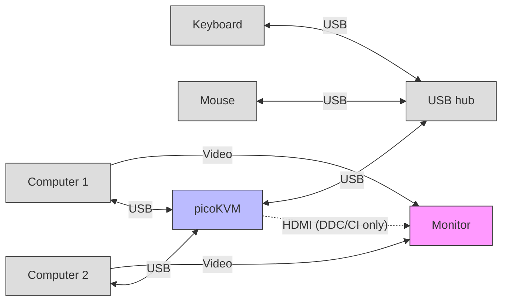

# PicoKVM
An inexpensive network KVM that can switch USB and monitor inputs simultaneously

## Why
Samsung makes great monitors, but they often lack a KVM. The project started as a way to switch them along with the USB devices, over their network API. It was later generalized to most monitors, driven over HDMI DDC/CI by its own board, while still driving network-controlled monitors and devices.

## Features
- Switches the USB devices and the monitors' inputs together
- Drives most monitors over HDMI DDC/CI, and others (or any device: a lamp, ...) over the network
- No video goes through it: every computer is connected directly to every monitor, so HDCP, VRR, G-Sync, FreeSync, HDR, ... work natively
- Controlled from its button, a web page or an HTTP API, from any device on the network

## Hardware
picoKVM runs on its own board, designed in [`hardware/`](hardware/README.md): an ESP32-S3, a USB 3.0 switch (two computers, one peripheral port), two HDMI ports carrying DDC/CI only (no video) to switch monitor inputs, an RGB status LED, and a Grove port for an [M5Stack key unit](https://shop.m5stack.com/products/mechanical-key-button-unit) as the switch button.


The original build (M5Stack AtomS3 Lite + USB multiplexer) is no longer supported; its last version is [5d5997c](https://github.com/FuNK3Y/picoKVM/tree/5d5997c).

## Install
1. Open the **[browser installer](https://funk3y.github.io/picoKVM/)** in Chrome or Edge, and plug the board's AUX / FLASH USB-C port into the computer.
2. Install, then connect the board to your Wi-Fi from the same page.
3. *Visit device* opens the [settings page](#settings-page): set an admin password, the input names and the monitors.

Until an admin password is set, the settings page and the API calls that change the device are open to anyone on the network.

## Monitors
Monitors are set on the [settings page](#settings-page): a form for DDC/CI monitors, JSON for the others ([`config.example.json`](config.example.json) has one of each).

### DDC/CI
Connect an HDMI cable from one of the board's HDMI ports to the monitor, and enable DDC/CI in the monitor's menu. For each computer, set the monitor's input value (VCP `0x60`): commonly `15` (DisplayPort 1), `16` (DisplayPort 2), `17` (HDMI 1), `18` (HDMI 2). Some monitors use their own values: read them with `ddcutil getvcp 60` (Linux) or *ControlMyMonitor* (Windows) while each input is active. *Power the monitor on first* wakes up monitors that keep DDC/CI alive in standby.

The monitor must accept DDC/CI on an input that is not the active one: it is showing another computer when the command arrives. Most do; tested so far on **AOC, Samsung, Dell, Acer and Lenovo** monitors. Some monitors have no DDC/CI at all (the Samsung G80SD): use the network instead.

### Samsung remote API
For Samsung smart monitors without DDC/CI (the G80SD), the KVM sends remote key presses over the network: enable IP remote on the monitor *(Connection > Network > Expert Settings)*. Find a repeatable sequence of keys that selects each input from the home screen, and write it with the [key codes](https://github.com/ollo69/ha-samsungtv-smart/blob/master/docs/Key_codes.md) as a `SamsungMonitor` device: see [`config.example.json`](config.example.json). `KEY_RETURN` first also wakes the monitor up; `command_delay` (and a `delay` on any key) slows the sequence down if the monitor's menu cannot keep up.

### Other network devices
A `GenericDevice` sends an HTTP request per input, e.g. to the [SmartThings API](https://github.com/ollo69/ha-samsungtv-smart/issues/274#issuecomment-2597627685) (untested): see [`config.example.json`](config.example.json).

## How to use
- Connect the computers' video directly to the monitors
- Connect each computer's USB to the KVM, and the keyboard and mouse to its peripheral port (through a hub, which can be the monitor's own)
- Connect the board's HDMI ports to the monitors driven over DDC/CI (control only, no video)



Then switch with the button, the web page or the API. The device answers at `http://picokvm.local` (its hostname is in the settings).

### Web page
`http://picokvm.local` switches with one button, and follows the KVM whoever switches it.

### Settings page
*Settings*, below the button, edits everything: Wi-Fi, input names and colors, LED brightness, admin password, monitors, and [updates](#updates). It asks for the admin password once one is set (any user name).

### API
```sh
curl -X POST http://picokvm.local/api/active_input/A   # or B; without the input, toggles
curl http://picokvm.local/api/active_input             # the state: active input, switching, last error
curl http://picokvm.local/api/events                   # the state as server-sent events, on every change
```
`/api/config` reads (`GET`) and writes (`POST`) the configuration, without the passwords. `/metrics` gives Wi-Fi signal, memory, USB power and version for Prometheus.

## Updates
*Check for updates*, then *Install*, on the settings page installs the latest [release](https://github.com/FuNK3Y/picoKVM/releases) over the network; *Upload* installs a `firmware-ota.bin` of your own. Settings are kept. The first boot of an update is a trial: if the device is not back on Wi-Fi within 2 minutes, it returns to the previous firmware.

The same from the command line (`-u` only once an admin password is set):
```sh
curl -u admin:<admin_password> -X POST http://picokvm.local/api/update/latest
curl -u admin:<admin_password> --data-binary @firmware-ota.bin http://picokvm.local/api/update
```

The API is plain HTTP, so the password can be read by anyone watching the network; and MicroPython does not check GitHub's certificate when downloading a release.

## ESPHome
The board can also run [ESPHome](https://esphome.io) instead of this firmware, for a native Home Assistant integration (DDC/CI monitors only). Include the [esphome/picokvm.yaml](esphome/picokvm.yaml) package, then name the computers and set the number of monitors:

```yaml
packages:
  picokvm: github://FuNK3Y/picoKVM/esphome/picokvm.yaml@main

substitutions:
  inputs:
    a: Work laptop
    b: Gaming PC
  monitors: 2
```

Each monitor's input values are then set from Home Assistant. [esphome/example.yaml](esphome/example.yaml) is a complete starting point; it builds, but has not been run on a board yet.

## Development
[`firmware/build.sh`](firmware/build.sh) builds MicroPython with `src/` frozen in, into `firmware/build/` (needs [ESP-IDF](https://docs.espressif.com/projects/esp-idf/en/v5.5.2/esp32s3/get-started/) v5.5.2):
```sh
. $IDF_PATH/export.sh
firmware/build.sh
```
CI runs the same build on pull requests and `main` and keeps the images as an artifact. A `v*` tag publishes a release and the [installer](install/index.html) to GitHub Pages.

The tests run the application on CPython, with stand-ins for the board ([`tests/mocks.py`](tests/mocks.py)); CI requires 95% coverage:
```sh
python3 -m unittest discover -s tests
```
