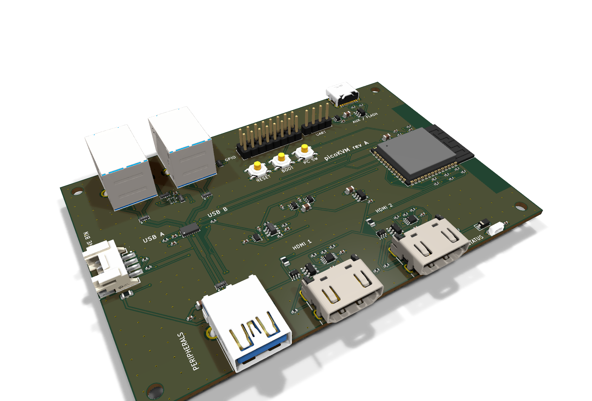
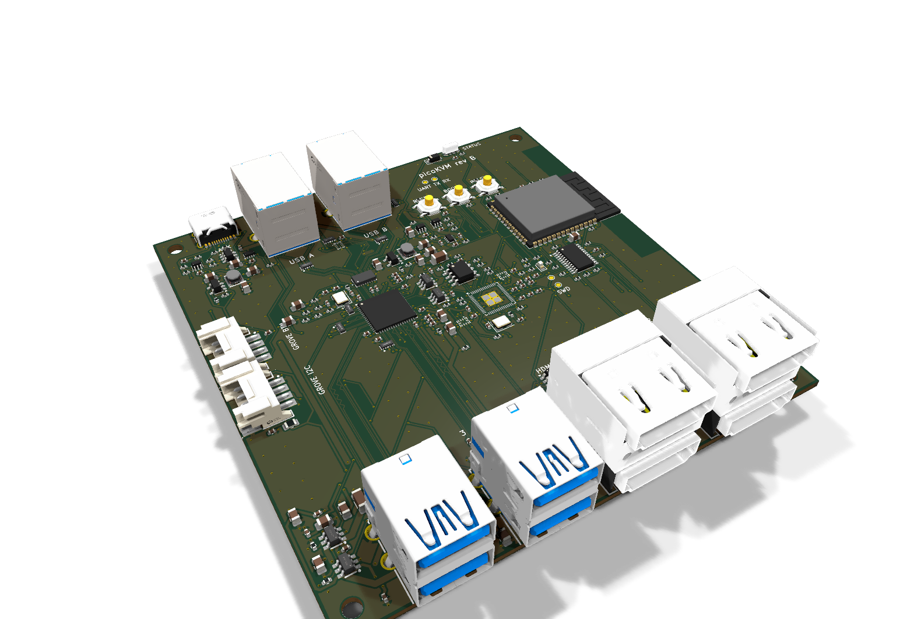

# picoKVM board — ESP32-S3 USB 3.0 KVM switch with HDMI DDC/CI

Two PCs (USB 3.0 Type-B) share one peripheral port (USB 3.0 Type-A).  An
ESP32-S3 flips the USB path and tells both monitors to change input over
HDMI DDC/CI.  The HDMI ports carry DDC/+5V only — video goes straight
from the PCs to the monitors.  The firmware is the MicroPython code in
`src/`, built into a MicroPython image by `firmware/` (see the main [README](../README.md)).



## Rev A release (ordered 2026-10-03, JLCPCB)

`revA/` holds the board exactly as it was sent to JLCPCB.  Freerouting is not
deterministic, so **`revA/kvm_board.kicad_pcb` is the design of record**: a
fresh `./build.sh` produces an equivalent board, not the same copper.

| file | what |
|---|---|
| `revA/kvm_board.kicad_pcb` / `.kicad_pro` / `.kicad_dru` | routed board (KiCad 10), its net classes and JLC design rules |
| `revA/jlcpcb/gerbers.zip`, `bom.csv`, `cpl.csv` | the files uploaded to JLCPCB (126 × 75 mm customer panel) |
| `revA/schematic_review.html` | readable schematic: every pin, its net and what else is on it |
| `revA/mechanical.txt` | connector, LED and button positions for the enclosure |
| `revA/thermal_justification.md` | proof that every single-spoke GND pad reaches the In1 plane |
| `revA/impedance.txt` | field-solver results for the 90 Ω pairs on JLC04161H-3313 |
| `revA/img/` | renders (top, bottom, iso, panel) and the Grove J8 pinout |

JLC order settings: 4 layers, 1.6 mm, **specified stackup JLC04161H-3313**,
no impedance control (accepted risk for prototypes, see below), 0.3 mm vias,
1 oz outer / 0.5 oz inner, flying-probe test, Standard PCBA top side,
**edge rails added by customer**, confirm production file and parts placement.

To regenerate the order files from the released board without re-routing:

```
mkdir -p out && cp revA/kvm_board.kicad_* out/
./build.sh fab        # panel (hw/panel.py), Gerbers, PTH/NPTH drill, BOM, CPL -> out/jlcpcb/
```

## Rev B (order files ready, branch `rev-b`)



`revB/` holds the board as it is to be sent to JLCPCB.  As for rev A,
**`revB/kvm_board.kicad_pcb` is the design of record**: `./build.sh` routed
it to 6 open connections, and the last ones were closed by hand on the routed
board (local rip-up and re-lay of a few control lines around the hub's
north-east pins and the RP2350's QSPI bus, gap joins on the VBUS trunks, port
3's VBUS widened in place, three dangling vias removed).  A fresh build gives
an equivalent placement, not this copper.

| file | what |
|---|---|
| `revB/kvm_board.kicad_pcb` / `.kicad_pro` / `.kicad_dru` | routed board (KiCad 10): DRC 0 errors, 0 unconnected, `checks.py` passed |
| `revB/jlcpcb/gerbers.zip`, `bom.csv`, `cpl.csv` | order files (112 × 102 mm customer panel, rails left and right), JLC DFM checked 2026-11-16 |
| `revB/schematic_review.html` | readable schematic |
| `revB/mechanical.txt` | connector, LED and button positions for the enclosure |
| `revB/impedance.txt` | field-solver results for the 90 Ω pairs |
| `revB/img/` | renders (top, bottom, iso) |

JLC DFM on these files (2026-11-16): the red items are understood and
accepted: pad-to-track 0.073–0.10 mm at 0402 pad corners (JLC reads KiCad's
rounded pads as sharp rectangles; KiCad DRC checks the real shape at 0.1 mm),
0.075 mm via annular rings (JLC minimum 0.05 mm), THT-to-SMD spacing at the
HDMI stacks, thermal vias under the RP2350, edge connectors at the edge, and
lead-edge flags on fine-pitch parts ("pin without pad" and "missing hole" are
0).  Check the J1/U11 and J8/J11 3D-model collision warnings in JLC's viewer
before ordering.  Order settings as rev A (4 layers, JLC04161H-3313, top-side
Standard PCBA, edge rails added by customer).

Port supply path (DC resistance of the routed copper, 1 oz outer, from
`revB/kvm_board.kicad_pcb`): USB A J1 → U4 34 mΩ, U32 → port switches
40–64 mΩ, switches → connectors 8–66 mΩ (port 3 66 mΩ); with all four ports
at 1 A, VBUS_HUB drops 111–152 mV.  Rev B's first routing measured ~0.5 Ω
PC-to-port before the 1 mm trunks (`hw/route_nets.py` POWER_TRUNKS).

Hub decoupling: the TUSB8041's +1V1 pins drop through vias onto a B.Cu ring
under the package; C71 sits in the hub's south-west corner (U43 moved down
its USB 2.0 line to make room), 3–8 mm from the west-side pins 5/8/13/21.  A
north-west corner capacitor was tried and dropped: it left the hub's
east-side control lines unroutable.

Rev B adds a TUSB8041 hub with four downstream ports (two stacked USB 3.0
Type-A, J3 and J10), an RP2350 that can intercept the keyboard on port 4,
**four HDMI DDC/CI ports on two stacked connectors** (J5, J6: Foxconn
QJ11191-DFB2-4H) and a TCA9548A I2C multiplexer for the four DDC buses, the
hub's SMBus and a second Grove port.
Pinout changes are under "Rev B: differences from rev A" below.  Several rev A
sections further down no longer describe this board:

| rev A statement below | rev B |
|---|---|
| Board 112 × 75 mm | **98 × 102 mm**, same 4-layer JLC04161H-3313 stackup, top-side assembly |
| Two single HDMI receptacles | Two stacked HDMI receptacles: J5 lower = HDMI 1, upper = HDMI 3; J6 lower = HDMI 2, upper = HDMI 4 (each port with its own 100 mA PTC, USBLC6 and 2k pull-ups; one LM66100 per connector feeds both its ports) |
| No AC-coupling caps on the SuperSpeed lines | The hub's downstream and upstream TX pairs are AC-coupled on the board (C60–C69); the PC-side mux path is unchanged |
| All SuperSpeed pairs on F.Cu | Ports 1/3 RX pairs run partly on B.Cu (referenced to In2 +3V3) |
| ESP32 footprint is the only exposed pad with vias | U30 (hub) and U45 (RP2350) use KiCad's ThermalVias footprints |
| U5 AP2112K LDO, one peripheral port behind U20 | 3.3 V and 1.1 V from two TLV62569 bucks (U5, U31); one TPS2553 per port (U33–U36) behind U32 |
| Prototype test plan (rev A) | see the rev B envelope below |

How the rev B board is laid out and routed, in addition to "How the board is
routed": capacitors and resistors that belong at a pin are tagged in the
schematic (`at=(ref, pin)` in `hw/kvm_board.py`) and placed there by
`make_pcb.py`; `layout.py` keeps routing corridors free of passives (pairs,
the hub's east-side lines, the RP2350's USB escape); `hw/route_nets.py`
pre-routes the nets Freerouting kept leaving open (regulator switch nodes and
feedback, both crystals, the hub's port-control lines, QSPI, the RP2350's USB)
and ties the +1V1 vias into one tree.  The CPL check in `make_fab.py` compares
JLC's pin names with ours (`hw/lib/jlcref/lcsc_pins.json`) and turns D5
(C2286, whose JLC symbol numbers the anode as pin 1) by 180°.

### Rev B prototype power envelope

The four ports can ask for more current than the board's shared supply path
can give: four TPS2553 limits (1.2–1.38 A each) behind one TPS2116 (2.5 A
class), fed by one PC port (0.9 A for USB 3) or the AUX input, and U32 falls
back from AUX to the selected PC the moment AUX goes away.  There is no
aggregate current limit.  Until that is designed in, rev B prototypes are run
inside this envelope:

- **Downstream load, all four ports together: ≤ 0.5 A** (keyboard, mouse and
  low-current devices), whether or not AUX is plugged in, since unplugging
  AUX moves the whole load onto the selected PC.  Measure the board's own
  current on the first prototype and lower the 0.5 A by whatever it exceeds
  0.35 A.
- **No bus-powered drives, chargers or four-port full-load tests, not even
  from a strong bench supply on AUX:** the load still goes through U32 (2.5 A
  class) and the board's shared copper, and falls back onto the selected PC
  when AUX is unplugged.  A higher-current experiment needs its own test plan
  (current-limited source, no PC attached).  Start with no downstream load
  until the board's own current has been measured in its operating states
  (idle, all HDMI monitors attached, Grove modules, ESP32 Wi-Fi active).
- **Grove I2C (J11):** only modules powered from the board's own J11 5 V.  An
  independently powered module with pull-ups to its own 5 V leaks ~0.2 mA per
  line into +3V3, or ~0.5 mA into an unpowered board.
- **HDMI +5 V (pin 18):** measure it with each monitor; it can fall below the
  4.8 V minimum from a weak PC port, as on rev A.  Four monitors can draw up
  to 4 × 55 mA = 0.22 A from +5V_SYS: count it in the board's own current.
- **Port power-off is not a power cycle:** the TPS2553s have no output
  discharge, so a port's 44 µF can hold VBUS well past 200 ms with a light
  load.  Firmware treats a hub reset / port disable as a data disconnect only.
- **Bring-up checks beyond rev A's:** hub enumeration from cold several times
  (crystal start-up); USB 3 and USB 2 throughput on every port; VBUS at each
  port at 0.5 A; scope +5V_SYS and VBUS_HUB when plugging the PCs and AUX one
  after another (inrush: ~30 µF on +5V_SYS and 210 µF on VBUS_HUB with no
  current limit), on a protected source.

## Build

```
./build.sh          # netlist + ERC, PCB, routing, DRC, renders, JLCPCB files (all in Docker)
./build.sh noroute  # same, stopping at the placed, unrouted board
./build.sh reroute  # route the board in out/ as placed (placement runs may reorder footprints, which changes routing)
./build.sh autoroute  # one more Freerouting pass on the board in out/
./build.sh parts    # re-import the LCSC symbols/footprints/3D models
./build.sh shell    # shell inside the toolchain (KiCad 10 + SKiDL + easyeda2kicad)
```

Sources:

| file | what |
|---|---|
| `hw/kvm_board.py` | the schematic, as SKiDL code — edit this, not the netlist |
| `hw/make_pcb.py` | builds the 4-layer `.kicad_pcb`: placement, planes, net classes, JLC rules |
| `hw/route_ss.py` | hand-designed USB 3.0 SuperSpeed pairs (coupled, matched, no vias) |
| `hw/route_usb2.py` | hand-designed USB 2.0 pairs (coupled, matched, symmetric via pairs) |
| `hw/finish.py` | power neck-downs + plane fanout before routing; GND stitching after |
| `hw/layout.py` | rev B placement: anchors, hand-placed passives, passive-free corridors, board size |
| `hw/placement_freeze.py` | frozen passive spots from an earlier placement, so routing-relevant positions stay put |
| `hw/pairs.py`, `hw/route_pairs.py` | rev B pair router and the hub's SuperSpeed / USB 2.0 pairs |
| `hw/route_nets.py` | grid pre-router for nets Freerouting left open, the 1 mm VBUS trunks and the +1V1 tree |
| `hw/plot.py` | 2-D plan of a board window (`out/img/plan.svg`) for layout work |
| `hw/route.py` | Freerouting round-trip (Specctra DSN/SES) for everything else |
| `hw/impedance.py` | 2-D field solver for the 90 Ω pairs on the JLC 3313 stackup |
| `hw/make_fab.py` | JLCPCB `bom.csv` / `cpl.csv` (CPL expressed in JLC's own footprint frame) |
| `hw/panel.py` | JLC assembly panel: rails, mouse bites, fiducials, tooling holes |
| `hw/thermal_report.py` | proves every single-spoke GND pad reaches the In1 plane |
| `hw/checks.py` | manufacturing checks beyond DRC, tuned to JLCDFM: vias near pads, SMD near through-hole pads, tracks near mask openings, USB 2 skew (`./build.sh checks`; part of every build) |
| `hw/review.py` | generates `schematic_review.html` |
| `hw/jlcref.py` | fetches JLC's footprints into `hw/lib/jlcref/` (used by `make_fab.py`) |
| `hw/lib/` | LCSC/EasyEDA imports; only the 3D models the board uses are committed (`./build.sh parts` re-fetches the rest, incl. STEP) |

Outputs in `out/`: `kvm_board.kicad_pro/.kicad_pcb` (open in KiCad 10),
`kvm_board.net`, `kvm_board.erc`, `drc.rpt`, `img/`, `jlcpcb/`,
`mechanical.txt` (positions for the case) and **`schematic_review.html`** —
the reviewable schematic: every chip and connector pin with its net and what
else is on it, grouped by function, plus a net index and automatic checks.

## Status

- [x] Circuit complete, ERC clean (0 errors / 0 warnings); D3 pin 3 (DOUT) is
      explicitly marked no-connect (single LED, no chain)
- [x] All parts in JLCPCB/LCSC stock (checked 2026-10-01); passives are basic parts
- [x] Placed and **fully routed**: DRC 0 errors, 0 unconnected.  Board:
      `out/drc.rpt`; JLC panel: `out/drc_panel.rpt`.  `min_resolved_spokes`
      is 1; every pad that would have a single outer-pour spoke is proven to
      reach the In1 GND plane independently in `out/thermal_justification.md`
- [x] 90 Ω pair geometry verified with a 2-D field solver (`hw/impedance.py`, see below)
- [ ] Human review of `out/schematic_review.html` (the schematic is code)
- [ ] Human review of the autorouted part in KiCad (DRC-clean and fully
      connected; not yet reviewed by eye)
- [x] Ordered from JLCPCB (5 assembled boards, rev A), files in `revA/`
- [ ] JLC production file and placement preview approved
- [ ] Prototype bring-up per the test plan below; DDC/CI with your monitors

`lib_footprint_issues` in `drc.rpt` only appears in the headless container
(no global library table) and can be ignored.  `lib_footprint_mismatch` on D3 is
intentional: the build replaces that EasyEDA footprint's open courtyard with a
closed rectangle and corrects its 3D-model offset (`hw/make_pcb.py`
`FIX_COURTYARD`, model offset in `hw/lib/lcsc.pretty`); its pads, numbering,
mask and paste are unchanged, and JLC's SMT check (its own C5378721 model on
our pads via the CPL) reports no pin-edge finding for D3.

### Toolchain

All versions are pinned (Dockerfile / `build.sh`): KiCad 10.0.8
(`kicad/kicad:10.0.8-full`), SKiDL 3.0.0, easyeda2kicad 1.0.1,
Freerouting 2.5.0 on `eclipse-temurin:25.0.5_8-jre`.

KiCad's Python bindings occasionally segfault in standalone scripts — on
both 9.0.9 and 10.0.x, mostly around zone filling.  Every script saves only
when its work is done and leaves via `os._exit(0)`, and `build.sh` retries
a crashed step (you'll see "crashed, retrying" in the log).  Routing results
vary slightly from run to run because Freerouting is not deterministic.

## How the board is routed

1. **USB 3.0 SuperSpeed** (`route_ss.py`): six pairs routed deliberately on
   F.Cu over the In1 GND plane — coupled 0.15/0.15 mm, 45° corners in
   cancelling pairs, intra-pair skew ≤ 0.1 mm, no vias, straight through
   the flow-through ESD parts.  Locked.
2. **USB 2.0** (`route_usb2.py`): the three switched pairs (USB A, USB B,
   peripheral) routed the same way — coupled 0.15/0.15 mm from connector to
   switch, D+/D− skew 0.000 mm (a 0.6 mm trombone on the peripheral pair
   cancels its one unbalanced 90° turn), symmetric via pairs where a pair
   changes layer (USB A: 0 vias, USB B: 4, peripheral: 6, i.e. 3 symmetric
   pairs; the B.Cu sections reference In2 (+3V3), the F.Cu ones In1 (GND)), straight through
   flow-through TPD4E05U06 ESD parts.  The TS3USB221A switch keeps each
   pair on adjacent pins, so pairs only separate for the last 0.1 mm into
   0.5 mm-pitch pads.  Locked.
3. **Pre-route** (`finish.py fanout`): every GND / +3V3 SMD pad gets a stub +
   via into its plane (In1 = GND, In2 = +3V3); fine-pitch power pins get
   neck-down stubs.  Locked.
4. **Everything else** (`route.py` + Freerouting 2.5.0 on Java 25):
   power, I²C, GPIO, aux USB-C (Full Speed only) on F.Cu/B.Cu.
5. **Stitching** (`finish.py stitch`): GND vias on a 4 mm grid tie the F/B
   pours to In1.

## Stackup and impedance

- **JLC04161H-3313**: L1 signal, L2 GND, L3 +3V3, L4 signal.  Select this
  stackup when ordering.  USB pairs on L4 (B.Cu) reference the L3 +3V3
  plane, AC-coupled to GND by the decoupling capacitors.
- Net class `USB_DIFF`: 0.15 mm track / 0.15 mm gap.  Verified with
  `hw/impedance.py`, a 2-D quasi-static field solver of the cross-section
  using JLC's published 3313 data (prepreg 0.0994 mm, Dk 4.1; solder mask
  1.2/0.6 mil, Dk 3.8; trapezoid etch W−0.025 mm; 0.04 mm finished copper).
  The solver matches Hammerstad-Jensen within 1.1–1.6 % on single
  microstrips.  Result (`out/impedance.txt`):
  - **Zdiff ≈ 90 Ω** with solder mask (99 Ω without), converging to ~89–90 Ω
  - every tolerance corner (Dk ±0.2, prepreg ±10 %, heavier etch, thinner
    copper, W or S ±0.02 mm) stays within **86–94 Ω**
- **Rev A is ordered without impedance control** (+$33): an accepted risk
  for 5 prototypes.  The stackup is specified, so the geometry gives the
  calculated ~90 Ω, but it is not measured or guaranteed by the fab; USB 3
  is validated on the prototypes.  For production, order impedance control,
  90 Ω differential on L1 referenced to L2.  JLC's own calculator (web only) is
  the final word; this is the same class of computation.
- ESP32 antenna: flush with the right edge, with a copper keep-out rule area
  under it on all four layers (no tracks, vias, pads or plane fill), extending
  2.5 mm past the module's sides.  Freerouting and the fanout/stitching steps
  respect it.

## Design decisions (rev A)

- **No AC-coupling caps on the SuperSpeed lines.**  The PC and the device
  already AC-couple their transmitters, and the HD3SS3212 must be DC-biased
  from one side (datasheet SLASE74F §10.1).  Caps on the board would leave
  the switch floating.
- **TX/RX crossover:** PC SSRX (B pins 8/9) ↔ peripheral SSTX (A pins 8/9),
  PC SSTX (B 5/6) ↔ peripheral SSRX (A 5/6), via mux channels 0/1.
- **LM66100 CE is tied to VOUT**, not GND — that is what enables its
  reverse-current blocking, so USB A can't back-feed USB B.
- **TS3USB221A** (µQFN-10) as the USB 2.0 switch: unlike the TS3USB30E, its
  D+/D− pins are adjacent for every port, so the pairs stay coupled up to the
  pins.  S = L selects port 1 (USB A), same polarity as the HD3SS3212 and
  TPS2116, so one `USB_SEL` still drives all three.
- **USB 2.0 ESD**: TPD4E05U06 (the SuperSpeed ESD part, channel 1 only) in
  flow-through right after J1 and J2 and on the switch's common side, instead
  of USBLC6s off to the side: no stubs, 0.5 mm pitch.
- **HDMI +5V** (pin 18; HDMI asks 4.8–5.3 V): LM66100 ideal diode (~5 mV
  drop, blocks back-feed from the monitor; one per stacked connector, shared
  by its two ports) + 100 mA PTC per port.  Expect ~4.9 V from
  a 5.0 V PC port, ~4.5 V in the worst case (4.75 V port and a heavily
  loaded cable) — check on the prototype.
- **No added vias inside exposed pads**: the HD3SS3212's thermal pad joins
  its GND pins, which take vias outside the chip (no solder wicking, no
  filled vias needed).  The one exception is the ESP32-S3 module's own
  footprint (Espressif's land pattern), which has 0.3 mm thermal vias in its
  centre GND pad by design.
- Peripheral VBUS: the TPS2116 picks the source and follows `USB_SEL`
  (its PR1 pin), so power always comes from the PC whose data is selected.
  A TPS2553 after it switches the port on/off and limits it to 1.2–1.38 A
  (R_ILIM 20 kΩ) with a fault flag — one GPIO each, no pin combinations to
  get wrong.  The board itself is powered by whichever of USB A / USB B / AUX
  is present.

## Decoupling (rev A, per TI datasheets)

- U4 TPS2116: 1 µF on each VIN at the IC (C4 VBUS_A, C5 VBUS_B; datasheet
  9.2 / 10.1); C6 100 nF on VOUT (≥ 0.1 µF for soft start, 7.3.2), which is
  also U20's input capacitor (TPS2553: 0.1 µF next to IN).
- U6 / U7 LM66100: 1 µF on each VIN (C23, C24) and 10 µF on +5V_SYS between
  them (C25), datasheet 10.2 / 11.1.  U8 (AUX) has C10 / C11 beside it.
- Peripheral port after U20: 2 × 22 µF + 100 nF at J3.

## Prototype test plan (rev A)

USB host ports are specified for 0.9 A (USB 3) but their actual trip point
is not a design limit, so rev A is validated inside this envelope:

- **Base envelope:** nothing connected to J7/J9; HDMI +5 V, Grove and LEDs
  count in the measured board current.  Assume one PC port supplies both the
  board and the peripheral (the AUX input does not guarantee a favourable
  split).
- **Peripheral current:** 0.5 A minus whatever the measured board current
  exceeds 0.35 A, on a USB 3 host port (0.9 A budget); higher loads, and the
  test at the U20 limit (1.2–1.38 A), only from a source known to supply
  them (bench supply or powered hub).
- **Measure:** source VBUS, VBUS at J3 and the drop between them, at 0.5 A
  and (on a capable source) at the U20 limit — judge J3 against what the
  peripheral needs, not a fixed number; temperature of U4, U20 and the VBUS
  tracks with a thermal camera or thermocouple after 10 min at load.
- **Switchover:** scope +5V_SYS and VBUS_PERIPH while toggling USB_SEL with a
  load on J3.
- **Inrush at plug-in:** +5V_SYS carries ~21 µF (C11, C12, C25) charged
  through U6/U7/U8 with no current limit; scope VBUS at plug-in on A, B and
  AUX separately, and plug them one after another, on a protected source.
- **U5 AP2112K:** temperature with Wi-Fi active continuously (expected
  ~0.1 A average, ~0.17 W).
- **Grove short:** short GROVE_5V to GND; F4 (100 mA PTC) trips in seconds,
  not instantly — check that +5V_SYS and the ESP32 stay up, and that F4
  recovers.
- **HDMI +5 V:** voltage at J5/J6 pin 18 with each monitor (spec 4.8–5.3 V).
- **USB 3 / USB 2:** throughput with a real SuperSpeed device and a
  High-Speed device on each PC; DDC/CI with each monitor.

## Rev B: differences from rev A

Rev B is not pin-compatible with rev A; firmware tells the boards apart with
`BOARD_REV` (GPIO15: low = rev B, open on rev A).  `hw/kvm_board.py` is the
source of truth for rev B; the table under "Firmware contract" is rev A's.

| ESP32 GPIO | rev A | rev B |
|---|---|---|
| 1 / 2 | HDMI 1 DDC SDA / SCL | I2C SDA / SCL to the multiplexer U13 (TCA9548A, 0x70) |
| 4 | HDMI 2 DDC SDA | `I2C_MUX_RESET_N` (low = all channels off; 10k pull-up) |
| 5 | HDMI 2 DDC SCL | free |
| 6 / 7 | spare | AUX CC sense (ADC) / AUX VBUS sense |
| 10 | `PERIPH_EN` | `HUB_RESET_N` (same meaning: high = ports on) |
| 16 | `PERIPH_FAULT_N` | pulled up, no function (the hub handles over-current per port) |
| 18, 35-37, 48 | header J9 | RP2350 flash programming (SD1, SS, SCLK, SD0) and `RP_RUN` |
| 21 | header J9 | `KBD_INTERCEPT` |
| 38 / 39 | header J9 | free |
| 40 | header J9 | `HUB_CFG` (high = hub waits for SMBus configuration) |
| 41 / 42 / 47 | header J9 | `RP_LINK_ATTN` / `RP_LINK_TX` / `RP_LINK_RX` |

- **I2C:** every bus hangs off U13.  Write the channel mask to 0x70, then
  talk to the device: channel 0 HDMI 1 (monitor at 0x37), 1 HDMI 2 (0x37),
  2 hub SMBus (0x44), 3 Grove I2C port J11, 4 HDMI 3 (0x37), 5 HDMI 4 (0x37).
  HDMI 1/3 are the lower/upper port of J5, HDMI 2/4 of J6.  Select channel 2 only while
  `HUB_CFG` is high.  A bus held low is cleared by pulsing GPIO4 low.
- **No DDC level shifters:** rev A's two PCA9306 are gone.  U13 runs from
  3.3 V, so it passes at most 2.8 V to the ESP32 side while the HDMI side
  keeps its 2k pull-ups to 5 V (TCA9548A datasheet, "voltage translation").
- **RP2350 link:** RP GPIO20 -> ESP GPIO42 (`RP_LINK_TX`, UART1 TX), RP GPIO21
  <- ESP GPIO47 (`RP_LINK_RX`, UART1 RX), RP GPIO26 - ESP GPIO41
  (`RP_LINK_ATTN`); 220R in series, 10k pull-ups.  RP GPIO22 sits on the
  PC-switch button line (GPIO13).  With stock hid-remapper all four are
  plain open-drain hotkey outputs.
- **Grove:** J8 (left edge) is unchanged: button + LED.  J11 (left edge, right below J8) is
  new: I2C, M5Stack port A pinout (GND, 5 V via its own 100 mA PTC, SDA
  yellow, SCL white), 4.7k pull-ups to 3.3 V on the board.
- **Removed:** GPIO header J9 and UART header J7 (UART0 is on two test pads).

## Firmware contract

Implemented by the firmware in `src/` (`src/board.py` holds these pins).

| GPIO | function |
|---|---|
| 1 / 2 | HDMI 1 DDC SDA / SCL (I2C0) |
| 4 / 5 | HDMI 2 DDC SDA / SCL (I2C1) |
| 6 / 7 | spare (not broken out; HDMI hot-plug detect is deliberately not wired: DDC/CI needs only SDA/SCL + 5 V, and a monitor can be found by probing I2C 0x50) |
| 8 | `USB_SEL` — low = USB A, high = USB B: USB 3 + USB 2 data **and** peripheral power source |
| 9 | `USB_OE_N` — low = data muxes on (pulled up: off at reset) |
| 10 | `PERIPH_EN` — high = peripheral power on (pulled down: off at reset) |
| 16 | `PERIPH_FAULT_N` — input, low = peripheral over-current / over-temperature |
| 11 / 12 | USB A / USB B VBUS present (10k/15k divider: 5 V → 3.0 V, max 3.3 V at an out-of-spec 5.5 V) |
| 13 | PC-switch button, active low: on-board SW3 **and** Grove J8 key, M5 white wire |
| 14 | on-board status LED data (SK6812 RGB, GRB order, 800 kHz) — set the colour per selected PC |
| 15 | spare (not broken out) |
| 19 / 20 | native USB (aux USB-C) |
| 17 | remote button RGB LED data (SK6812), Grove J8 LED, M5 yellow wire |
| 43 / 44 | UART0 on J7 (GND, TX, RX, 3V3) |
| 18, 21, 35–42, 47, 48 | spare, on J9 |

### Connectors for the box

- **J8 — Grove (HY2.0-4P), left edge, centred — M5Stack pinout:**
  looking into the socket from outside, latch window on top, left to right:
  GND, **5 V** (via 100 mA PTC), LED data (GPIO17, SK6812/NeoPixel), key
  (GPIO13, active low, 10k pull-up on board).  On an M5Stack cable that is
  black, red, yellow, white -- verified against a real Unit Key.  (The
  footprint's pad 1 is GND; Seeed cables use other colours.)
  100 Ω series resistors on both signals.  Made for the M5Stack Unit Key
  (mechanical key + RGB LED): it plugs straight in.  Avoid Seeed Grove
  modules that pull their signal up to VCC — they would put 5 V on an ESP32
  pin.
- **J9 — 2×8 header, 2.54 mm (assembled, C68234):**

  Even pins are the row nearest the ESP32, in module-pin order, so the
  fan-out is straight:

  | pin | signal | pin | signal |
  |---|---|---|---|
  | 1 | GPIO48 | 2 | GPIO35 |
  | 3 | GPIO47 | 4 | GPIO36 |
  | 5 | GPIO21 | 6 | GPIO37 |
  | 7 | GPIO18 | 8 | GPIO38 |
  | 9 | GND | 10 | GPIO39 |
  | 11 | 3V3 | 12 | GPIO40 |
  | 13 | 5V (5V_SYS) | 14 | GPIO41 |
  | 15 | GND | 16 | GPIO42 |

  The module is the **N8R2** (8 MB flash, 2 MB quad PSRAM).  GPIO35–37 are
  free only because its PSRAM is quad SPI — don't substitute an octal-PSRAM
  module (N8R8, N16R8…), which uses those pins internally.  The firmware is
  built on MicroPython's plain ESP32_GENERIC_S3 configuration: it detects the quad PSRAM at boot (the
  `SPIRAM_OCT` variant is for octal PSRAM and won't start it).  GPIO39–42 are also the JTAG pins (usable as
  normal GPIO; JTAG is over USB on the S3).  The 5V pin is the board's
  internal rail (ideal-diode OR of the USB inputs) — keep loads small.
- **J7 — UART header (assembled, C32713270):** GND, TX, RX, 3V3.

### Mechanical (for the enclosure)

- Board 112 × 75 mm (rev A; rev B is 98 × 102 mm), plain rectangle; the edge connectors protrude past it by
  up to 1.5 mm (see `out/mechanical.txt`).  The ESP32
  antenna is at the right edge, y 31–49: keep metal, screws and conductive
  filament ≥ 5 mm away from it; plain PLA/PETG walls are fine.
- Four M3 holes, 4 mm in from each corner; nothing within Ø8 mm of them.
- Edge connectors stick out up to 1.5 mm (2 mm wall − 0.5 mm); see
  `out/mechanical.txt` for each connector's edge, position and protrusion.
- Rear edge (PC side): USB A and USB B inputs (USB 3.0 Type-B), aux/flash (USB-C).
- Front edge (desk side): peripherals (USB-A), HDMI 1, HDMI 2, and the
  side-emitting RGB status LED (SK6812SIDE-A, lens 4 x 2 mm, centre 1 mm
  above the board), which shines straight out of the edge: a ~2 mm hole or
  light pipe in the wall is all it needs.  Its VDD comes from +5V_SYS through
  a 1N4148W (~4.3 V) so the 3.3 V data line clears VIH = 0.65 x VDD.
- Left edge: Grove button port, centred.  Right edge: ESP32 antenna.
- Buttons are 3 mm tall (TS-1187A-C-F-B): press them through flexures in the
  lid.  Positions in `out/mechanical.txt`.
- Inboard, rear: GPIO header J9, UART header J7, RESET / BOOT / PC-switch
  buttons (bench use; the Grove port is the user's button).

Switch sequence (every step is a single GPIO write):

1. `PERIPH_EN` = 0 — peripherals off
2. `USB_SEL` = target PC — data and power source follow together
3. wait ~200 ms — devices see a clean disconnect
4. `PERIPH_EN` = 1 — peripherals power up on the new PC and enumerate
5. send DDC/CI "input source" (VCP 0x60) to both monitors

MicroPython, e.g.:

```python
en.off(); sel.value(1); time.sleep_ms(200); en.on()   # switch to USB B
```

**Caveat:** many monitors only accept DDC/CI on the input currently being
shown.  Test your monitors with an ESP32 dev board + HDMI breakout before
ordering.
